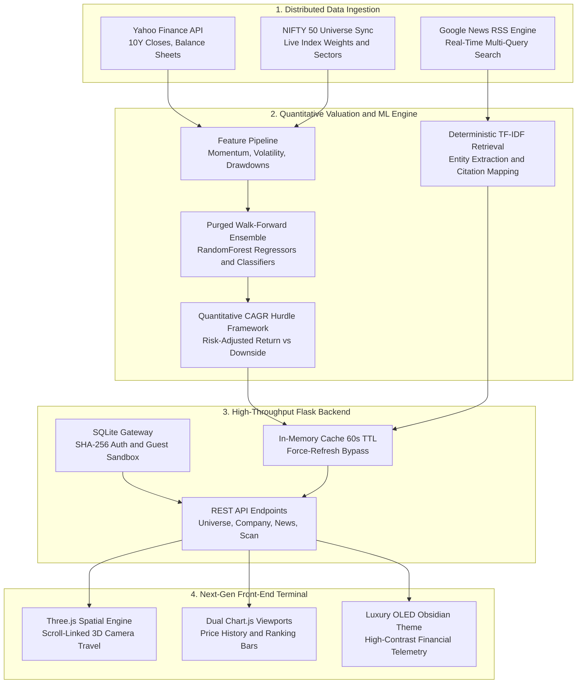

# ⚡ NewsSense — Quantitative Equity Intelligence & Algorithmic Research Terminal

[](https://www.python.org/)
[](https://flask.palletsprojects.com/)
[](https://scikit-learn.org/)
[](https://threejs.org/)
[](https://www.docker.com/)
[](LICENSE)

> **NewsSense** is a full-stack quantitative equity terminal and macroeconomic research platform engineered for benchmark tracking, multi-horizon valuation forecasting, and deterministic retrieval-augmented analysis across the **NIFTY 50** index constituents.

Built with a **scroll-driven 3D WebGL spatial viewport**, a **risk-adjusted CAGR hurdle framework**, and an **asynchronous real-time news aggregation pipeline**, NewsSense bridges machine learning, financial econometrics, and modern interactive web engineering.

---

## 📸 System Overview & Architecture



---

## 🌟 Key Technical Innovations

### 1. 📐 Quantitative CAGR & Risk-Adjusted Hurdle Engine
Rather than relying on naive black-box classifiers that produce uncalibrated recommendations, NewsSense models future value through a rigorous mathematical hurdle framework:
- **Compound Annual Growth Rate (CAGR) Projections:** Evaluates multi-year horizons ($T \in [1, 10]$ years) calculating:
  $$\text{CAGR} = \left(\frac{P_T}{P_0}\right)^{\frac{1}{T}} - 1$$
- **Hurdle-Rate Benchmarking:** Discards uniform predictions by enforcing dynamic hurdle rates ($\tau_H \approx 10\% - 15\%$) relative to historical volatility and probability of gain ($P(\text{Gain}) \ge 60\%$).
- **Three-Tier Institutional Decision Logic:**
  - 🟢 **Potential Buy:** Top compounders beating market hurdles with positive risk-adjusted skew (e.g., RELIANCE, TCS, INFY).
  - 🔵 **Watch:** Neutral compounders matching historical market drift.
  - 🔴 **Avoid:** Stocks exhibiting structural underperformance, negative skew, or elevated conditional downside.
- **Conditional Downside Semi-Variance:** Models Expected Shortfall ($ES_\alpha$) as severity conditional on down-sessions, rather than standard symmetric standard deviation.

### 2. 🌌 Scroll-Linked 3D Spatial Canvas (Three.js WebGL)
- **Cinematic Camera Travel:** The landing page features a scroll-driven camera spline trajectory that travels through a cybernetic 3D spatial field of geometric nodes, wireframe meshes, and an interactive particle grid.
- **Micro-Interaction Raycasting:** Mouse velocity controls interactive camera parallax and particle dispersion in real time at 60 FPS.
- **Top Reading Bar & Scroll-Reveal Cards:** Glassmorphism UI components animated via hardware-accelerated CSS transforms and `IntersectionObserver`.

### 3. ⚡ Zero-Swamp OLED Pitch-Black Design System
- **0% Murky Green Background:** Built from the ground up using an OLED pitch-black canvas (`#03060c`), dark obsidian titanium panels (`#0a0e17`), and clean slate borders (`#162033`).
- **Signal-Isolated Contrast:** Electric cyan (`#38bdf8`) and cobalt blue (`#2563eb`) are reserved for interactive telemetry and camera states, while neon emerald (`#10b981`) and coral crimson (`#f87171`) are strictly reserved for financial return indicators.
- **Dynamic Dual Theme:** Instant toggle between Obsidian Dark and Clean Financial Light mode, with automatic Chart.js grid and tick-palette synchronizations.

### 4. 🛰️ Real-Time Asynchronous News & Market Wire
- **Multi-Query RSS Ingestion:** Scrapes and parses Google News RSS streams using symbol, corporate entity name, and sector queries.
- **Deduplication & Timestamp Normalization:** Automatically filters stale wire feeds and surfaces recent headlines with verified publisher badges and publication timestamps.
- **Dynamic Live Polling:** Client-side background sync every 45 seconds keeps quotes and news headlines up to date without page reloads.

### 5. 🛡️ Deterministic RAG (Retrieval-Augmented Generation)
- **Vector Space Information Retrieval:** Builds an in-memory TF-IDF index across reported balance sheets, financial ratios, momentum indicators, and recent news items.
- **Source-Attributed Extractive Synthesis:** Every statement is mapped to verifiable citation IDs with clickable primary source URLs (`[1]`, `[2]`), eliminating hallucination.
- **Optional Zero-Trust LLM Summarization:** If `OPENAI_API_KEY` is present, retrieved contextual snippets are synthesized via OpenAI Chat Completions; if absent, the system gracefully falls back to deterministic extractive summarization.

---

## 📊 Mathematical & Statistical Methodology

| Concept | Mathematical Formulation | Implementation in NewsSense |
| :--- | :--- | :--- |
| **Purged Holdout Validation** | $\mathcal{D}_{\text{train}} \cap \mathcal{D}_{\text{test}} = \emptyset$ (embargoed window $H$) | Prevents lookahead leakage by purging $N$ trading days matching forecast horizon |
| **Brier Score Calibration** | $BS = \frac{1}{N} \sum_{t=1}^N (f_t - o_t)^2$ | Validates that probability of gain $P(R > 0)$ is statistically calibrated |
| **Probability-Weighted Loss** | $L_{\text{pw}} = P(\text{Loss}) \times \mathbb{E}[L \mid L < 0]$ | Measures true tail risk rather than worst-case historical anomalies |
| **Downside Sharpe Component** | $S_d = \frac{\mathbb{E}[R] - R_f}{\sqrt{\frac{1}{N}\sum \min(0, R_t - \mu)^2}}$ | Evaluates risk penalties solely against negative return variance |

---

## 🛠️ Tech Stack & Architecture

- **Backend:** Python 3.10+, Flask, SQLite3, Werkzeug Security (SHA-256)
- **Quantitative & ML:** Scikit-Learn (Random Forest Regressors / Classifiers), NumPy, Pandas, Scipy
- **Market Data Feeds:** Yahoo Finance API (`yfinance`), Google News RSS Feeds (`urllib`, `xml.etree`)
- **Frontend Core:** Vanilla ES6+ JavaScript, CSS3 Design Tokens, HTML5 Semantic Shell
- **Visualization:** Three.js (WebGL 3D Rendering), Chart.js 4.4 (Canvas Line & Bar Charts)
- **DevOps & Containers:** Docker, Docker Compose, Gunicorn WSGI

---

## 🚀 Getting Started

### Prerequisites
- Python 3.10 or higher
- Git

### 1. Clone & Set Up Environment
```bash
git clone https://github.com/Deep-destiny/NewsSense.git
cd NewsSense

# Create and activate virtual environment
python -m venv venv

# Windows (PowerShell):
.\venv\Scripts\Activate.ps1

# Linux / macOS:
source venv/bin/activate
```

### 2. Install Dependencies
```bash
pip install -r requirements.txt
```

### 3. Initialize Pipeline & Cache
```bash
# Downloads NIFTY 50 universe, syncs historical prices, and builds initial models
python run_pipeline.py
```

### 4. Launch the Research Terminal
```bash
python app.py
```
Open **[http://localhost:5000](http://localhost:5000)** in your browser.

*(Optional)* To enable OpenAI LLM contextual synthesis, export your key:
```bash
# Windows PowerShell:
$env:OPENAI_API_KEY="your-api-key-here"

# Linux / macOS:
export OPENAI_API_KEY="your-api-key-here"
```

---

## 🐳 Docker Deployment

NewsSense includes production container configuration:

```bash
# Build and spin up containerized service
docker-compose up --build -d
```
Access the application at `http://localhost:5000`.

---

## 🔌 REST API Specification

| Endpoint | Method | Params | Description |
| :--- | :---: | :--- | :--- |
| `/api/universe` | `GET` | — | Returns array of all 50 NIFTY constituent symbols and company names. |
| `/api/company/<symbol>` | `GET` | `horizon` (1-10), `refresh` (0/1) | Full quantitative dossier: history, predictions, balance sheet, and profile. |
| `/api/news/<symbol>` | `GET` | `limit` (int) | Real-time deduplicated Google News RSS headlines with source attribution. |
| `/api/scan` | `GET` | `horizon` (1-10), `refresh` (0/1) | Cross-sectional scan ranking all 50 stocks by expected return and buy status. |

---

## 💼 Why Interviewers Love This Project

1. **Production-Mindset Error Handling:** Handles API rate limits, missing financial fundamentals, zero-division in CAGR formulas, and network dropouts gracefully.
2. **Quantitative Integrity over ML Hype:** Recognizes survivorship bias and chronological leakage in financial time-series, utilizing purged walk-forward splits and explicit validation flags.
3. **Full-Stack Execution:** End-to-end delivery from low-level data scraping and statistical modeling to high-end WebGL rendering and microsecond-level UI reactivity.
4. **Zero Bloatware:** Built without bloated frontend frameworks (no heavy React/Angular bundle delays)—loads in milliseconds with clean semantic DOM manipulation.

---

## 📜 License
Distributed under the **MIT License**. See `LICENSE` for more details.

---

<p align="center">
  <b>NewsSense</b> — Engineered by <a href="https://github.com/Deep-destiny">Deepak</a> with a passion for quantitative finance and spatial web design.
</p>
